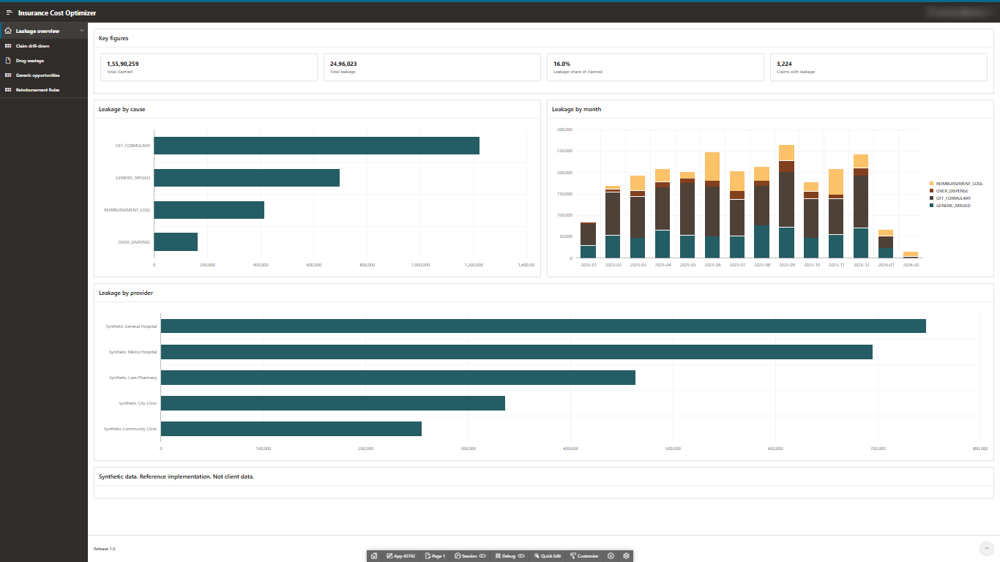
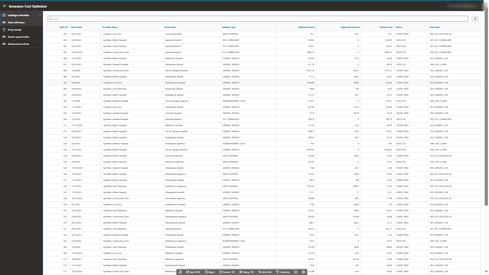
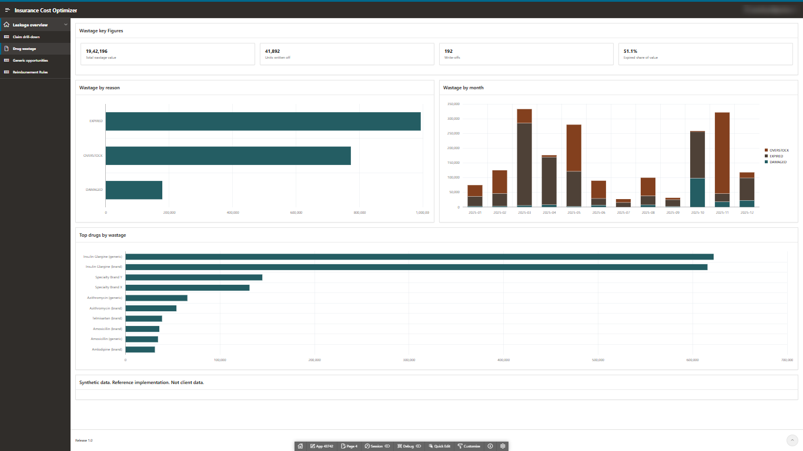
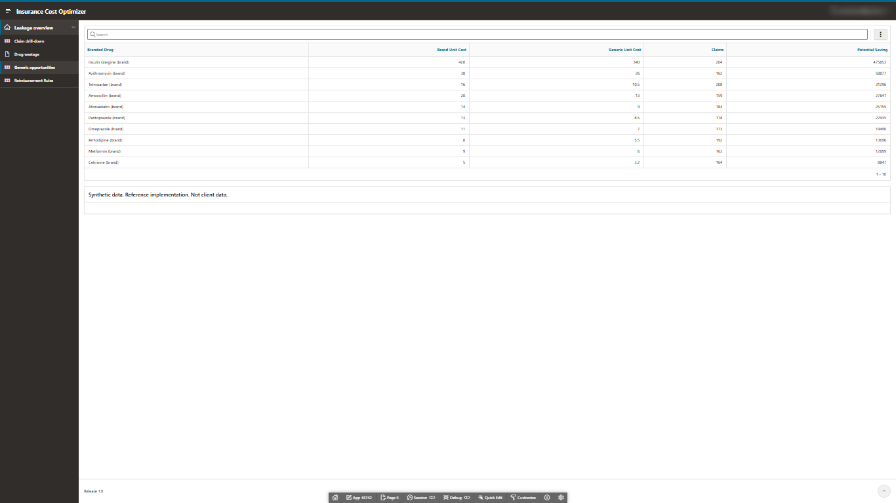
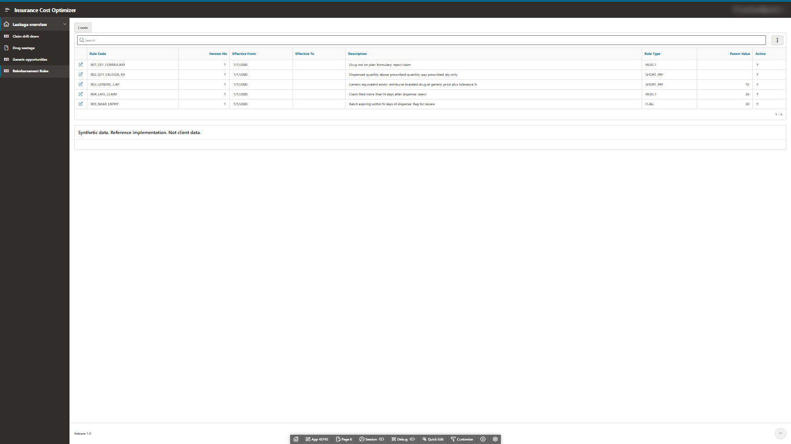
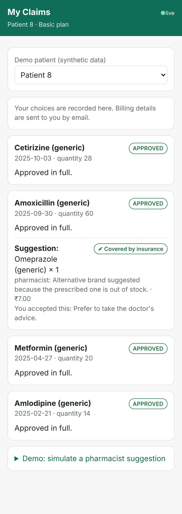
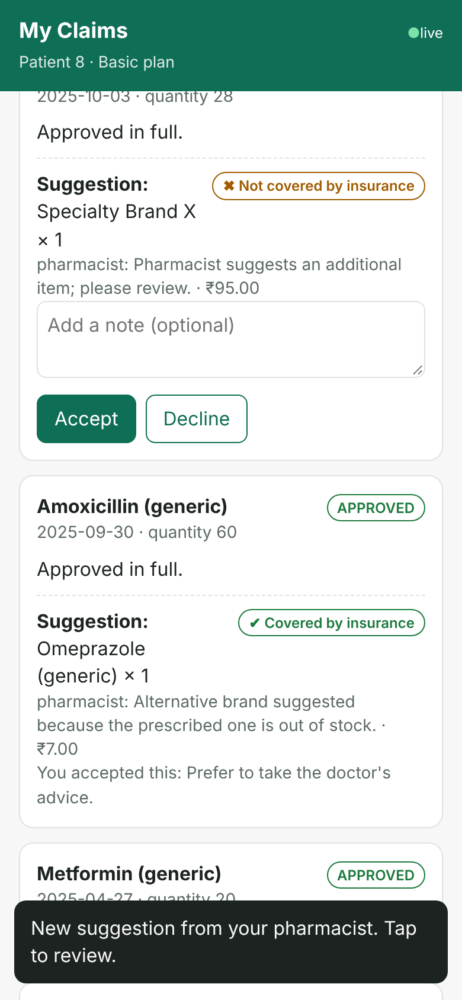
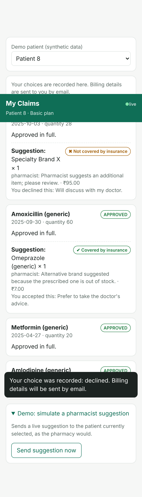

# apex-insurance-cost-optimizer

Reference implementation of a health insurance cost optimization app built on Oracle APEX, with pharmacy dispensing linked to claims and reimbursements.

> **All data in this repo is synthetic.** No client code, schema, rules or data is included. This is a reference implementation of the approach, not the delivered system. Numbers produced from the synthetic data demonstrate how the dashboards work; they are not results from any client engagement.

## What it shows

| Area | What the app does |
|---|---|
| Claim leakage | Finds money lost or paid out that rules should have prevented: generic substitution missed, over-dispensing, off-formulary dispensing, late claims |
| Drug wastage | Tracks expired, overstocked and damaged stock by drug, provider and month |
| Reimbursement rules | Rule table (reject, short-pay, flag) applied to each claim, so every approved or reduced amount traces to a rule |
| One record for everyone | Pharmacy, doctors, claims team and patient party see the same record (dispensed, claimed, approved, and why) |

## Screenshots (reference app, synthetic data)

Oracle APEX app (built and run in the repo owner's own APEX workspace; export in `apex/`):

| | |
|---|---|
| 1. Leakage overview: key figures, leakage by cause, by month, by provider |  |
| 2. Claim drill-down: every leaking claim with cause, amount lost and rule applied |  |
| 3. Drug wastage: by reason, by month, top drugs |  |
| 4. Generic opportunities: branded drugs dispensed where a cheaper generic existed |  |
| 5. Reimbursement rules: versioned rule table with edit form |  |

Patient app (a plain browser app that demonstrates the patient side; it is not an APEX app and reads the CSV files, not the APEX database):

| | |
|---|---|
| Patient app, claims |  |
| Patient app, live suggestion |  |
| Patient app, after the patient's decision |  |

Known limits of the reference app: the rules page edits the rule table but does not change claim decisions or any figure on the other pages (the leakage view and the synthetic claims apply the rules in fixed code); it has no manager authorization or change log; the patient app is not connected to APEX; the REST bridge in `apex-bridge/` was run once against a live workspace with a test row, and its send step is a print. See `docs/apex-bridge-test.md` and section 5 of `docs/case-study.md`.

## Repo layout

```
db/01_schema.sql              tables, leakage view, wastage view (Oracle 19c+)
db/02_reimbursement_rules.sql five reference rules
db/03_advisories_billing.sql  pharmacy advice, patient choice, system-set covered flag, patient bill view
db/04_security_audit.sql      edit authorizations, audit log (sketch)
db/05_insurer_integration.sql insurers, rules per insurer, rejection codes, claim submissions (sketch)
synthetic_data/generate_data.py   seeded generator (python3, stdlib only)
data/*.csv                    generated output (seed 42, 3,000 members, 12,000 claims)
notification-worker/          reference notification worker + tests (retry, cap, opt-out)
dashboard/                    claim leakage and drug wastage dashboard (open leakage-wastage-dashboard.html; rebuild with python3 dashboard/build_dashboard.py)
apex-bridge/                  REST bridge: reads PENDING outbox rows from APEX and writes the result back (live test passed once on a free workspace; send step is a print; see docs/apex-bridge-test.md)
insurer-sim/                  simulated insurer submission: lost reply, outage, duplicate, rejection reason (+ tests)
patient-pwa/                  patient progressive web app (browser, live updates) + demo server
docs/apex-build-guide.md       step-by-step build of the APEX app with checkpoint numbers
docs/apex-page1-steps.md       click-by-click steps for page 1
docs/architecture.md          architecture diagram, flow, guarantees and limits
docs/case-study.md            product owner + architect case study (draft skeleton)
apex/                         standard export of the APEX app, scrubbed (import steps in apex/README.md)
```

## Quick start

1. Run `db/01_schema.sql` then `db/02_reimbursement_rules.sql` in your APEX workspace schema.
2. `python3 synthetic_data/generate_data.py` (change `--seed` or `--members` as needed).
3. Load the data with the generated scripts in `data/sql/` (run each file in numeric order; regenerate with `python3 synthetic_data/make_sql_load.py`), or load the CSVs with APEX Data Workshop in this order: providers, insurance_plans, members, drug_master, prescriptions, dispense_records, claims, stock_wastage.
3b. Run `db/03_advisories_billing.sql`, then load `data/advisories.csv` (the trigger sets the covered flag from the drug and plan).
3c. Primary keys are `GENERATED BY DEFAULT ON NULL AS IDENTITY`, so the CSVs can load their own ids. After loading, move each identity forward so new rows do not collide with loaded ids, for example `ALTER TABLE claims MODIFY claim_id GENERATED BY DEFAULT ON NULL AS IDENTITY (START WITH LIMIT VALUE);` (repeat for each table you loaded). Verified on Oracle APEX (2026-11-19): `db/01` to `db/03`, the load scripts, row counts for all nine tables and the leakage view totals. `db/04` and `db/05` are sketches and have not been run.
4. Build the dashboard pages on `v_claim_leakage` and `v_drug_wastage` (see docs/case-study.md for the page plan).

## Note on the insurer decision
In the delivered system the insurer decided each claim and returned the decision through its API. In this reference app there is no insurer, so the generator simulates the outcome using the rules in `reimbursement_rules`; treat the approved and rejected amounts as simulated.

## Seeded patterns (ground truth for checking the dashboard)

Branded drug dispensed when a generic exists ~30% of branded dispenses, over-dispensing ~6%, off-formulary ~3% of prescriptions, late claims ~4%, near-expiry batches ~5%.

## Dashboard

`dashboard/leakage-wastage-dashboard.html` is a self-contained page (no internet needed) showing leakage by cause and month, drug wastage by reason and month, and the branded-instead-of-generic drugs with the largest avoidable cost. It uses the same leakage definition as `v_claim_leakage` and synthetic data only. It puts on one page cuts that, in the delivered system, were split between management's dashboard and the accounts team's reports. It stands in for the APEX dashboard pages 1 to 4 in the page plan until the APEX app export is added.

## Patient app (PWA)

A browser-based app for patients, no installation required (it can also be added to the home screen).

```
cd patient-pwa && python3 server.py     # then open http://localhost:8080
```

Shows claims with plain-language reasons, pharmacy suggestions marked covered or not covered by the system, accept or decline with a note, and a note that billing details go by email (the bill view in the database, `v_patient_bill`, is still there). Updates arrive live (Server-Sent Events). The demo does not include a bill screen, the invoice email, the OTP login, the session timeout or the audit trail; see docs/architecture.md and the upgrade options in the case study. Use the "simulate a pharmacist suggestion" panel to see a live push.

Scope note: updates arrive while the app is open or in a background tab. Push to a fully closed browser needs a push service (Web Push with VAPID keys, or the push notification option of an Oracle APEX PWA application). The demo server uses only the Python standard library. In the delivered system, a Python middle layer read the feed from APEX and sent notifications through Redis; this demo replaces that layer with in-process live updates.
