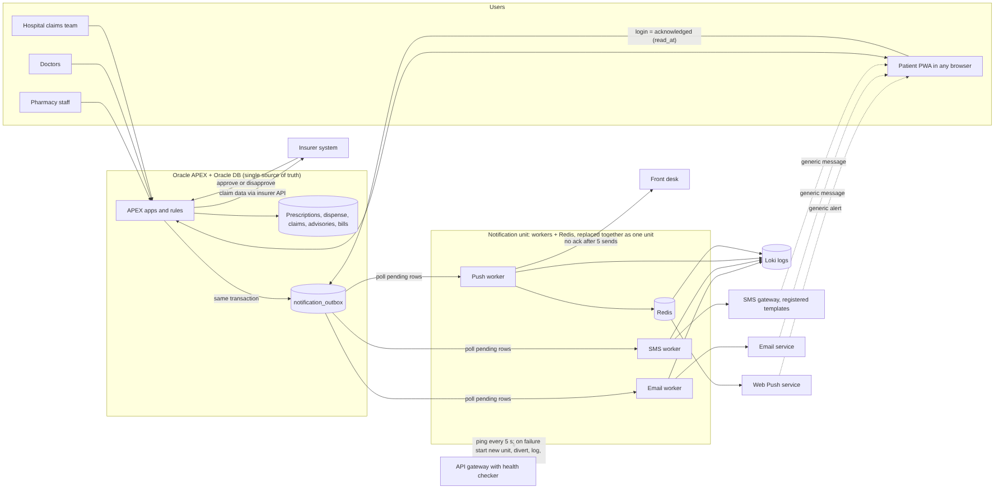

# Architecture (delivered design, reference implementation in this repo)

## Principles
1. **One source of truth.** Prescription, dispense, claim, advice, bill and notification records live in the APEX database. Every party (pharmacy, doctor, claims team, patient) sees the same record.
2. **Rules are data.** Reimbursement rules sit in a table the claims team can change without a release. The system, not staff, marks each item covered or not covered, and billing follows that mark and the patient's choice.
3. **Notifications are decoupled.** Delivery depends on third parties (email, SMS, push), so it runs outside APEX as microservices: one worker each for email, SMS and push, with Redis, forming one notification unit. Patient volume is modest (the client's maximum was 300 beds, tested at 500), so there is one unit, not several in parallel. A health checker service at the API gateway pings the unit every 5 seconds. If the unit fails, the health checker starts a new unit (workers and Redis together), diverts all requests to it, logs the event and alerts the system team.
4. **No health details in messages.** Every email, SMS and push says only that an update is available. Details show after the patient logs in.
5. **Login is the acknowledgement.** A message that was sent but never seen is not treated as delivered.

## Insurer integration (confirmed)
The insurer never used the application.
- **Integrated insurers (a few):** our system sends the claim data through the insurer's API. The insurer's API returns a submission tag, which locks the submission so it cannot be sent again. While the insurer decides, the claims team sees "decision pending at insurer end" and takes no action. When the insurer approves or disapproves, the system is updated with an alert and the next process starts in APEX. If the insurer's system is down, retries run automatically until it is up, and the API health checker alerts the claims team about the outage. Before sending, the app saves a marker in its own table and sends an idempotency key with the API call, so a retry after a lost reply cannot create a second submission. The app checks the patient's current status and rejects a submission when the patient already has an open claim.
- **Rules per insurer:** each integrated insurer has its own rule engine, set up from that insurer's rules at the time of integration, and versioned.
- **Rejections:** at integration time, the insurer's rejection codes are stored in a table with plain-language text. On a rejection the app shows the code, the plain-language text and any note sent from the insurer's end. When an insurer adds a new code, the insurer's API sends it in advance and the table is updated.
- **Insurers without an API:** the client advised a manual process: all documents are sent as a password-protected zip by email to the person assigned at the insurer. The password of the zip is randomly generated, encrypted with the insurer's public key and sent through a small key-delivery service for the insurer. The claims team enters the insurer's feedback and acts on the decision.
- **Consent:** taken at admission.
- **API security:** credentials together with encrypted transport.

## Notification flow
1. A business change (claim decision, dispense, pharmacy suggestion, bill) writes a row to `notification_outbox` in the **same transaction** as the change, so an update can never be lost or announced without existing.
2. The Python worker reads pending rows and, for each channel the patient consented to (chosen at admission or enrolment, opt-out by mutual consent), sends: email, SMS (pre-registered template), and a message to Redis that triggers Web Push for the PWA.
3. The next timer checks only the acknowledged marker. While it is false, the cycle repeats on all channels every 10 minutes. Three sends are enough in normal conditions; if email or SMS was down, or the push was ignored, up to two more follow, a hard cap of **5 sends**. Per-channel boolean flags record each channel's result, and no channel is sent again until the next timer.
4. If the patient still has not logged in after the cap, the **front desk is alerted** to call the patient's registered number.
5. When the patient logs in, the app sets the acknowledged marker (`read_at`) and retries stop. Logs of the Python and Redis services go to Loki.

Front-desk alert (confirmed): the alert carries only the patient and the update type, in keeping with the generic-message principle. When the type is "priority", it also gives the details of the person to contact immediately. The front desk has a screen in the app that lists pending alerts. Not built in the reference app, where the alert is a callback with only the patient and outbox ids. "Priority" is not about the patient's condition; this app does not track it. It marks an update that needs the patient party's immediate attention on billing, an invoice, medicine and the like. The patient party gets the usual email, SMS and push messages for a priority update, as for any other update, only marked as priority. What differs is the front desk: it calls at once, without waiting for the ordinary cycles to run out. The sending window does not change: no call or message of any kind goes out between 9 pm and 6 am, even for priority.
Who marks it: two roles, the claims manager and the hospital chief administrative officer. Only the person who marked it can cancel it, so neither can cancel the other's marking. The marker cancels it after a satisfactory reply from the patient party, enters remarks and closes it.
What happens: the front desk calls the marked patient party immediately (inside the window), enters the result of the call, and retries up to 5 times.
The message text itself carries a "priority" flag but no details, so the generic-message principle still holds.

## Guarantees and limits (stated plainly)
| Topic | What the design gives | Limit |
|---|---|---|
| Lost updates | None: outbox row is written with the business change | Only as reliable as the database |
| Delivery | At-least-once, until acknowledged or the cap | A crash between sending and marking can send one message twice; harmless because messages are generic |
| Push | Alerts a patient whose app is open, and a closed browser via Web Push | Browsers and phones may delay or drop push; this is why email, SMS and the front desk exist |
| Privacy | Generic text only | Email and SMS are not secure channels, which is why they carry no details |
| Offline patient | Sees all updates on next login | Time until they log in is outside the system's control, hence front desk escalation |

## Resilience and limits on volume (confirmed)
- **Self-healing unit:** the Python workers and Redis are treated as one unit. If either part goes down, the whole unit is considered down and a new unit (workers and Redis) is started automatically; all requests are diverted to it. The health checker pings every 5 seconds.
- **Nothing is lost during replacement:** pending updates wait in the outbox table in the APEX database. Redis messages in flight are lost when the unit is replaced, which is acceptable because Redis is only a trigger for a generic push; the outbox row stays unacknowledged and the next timer resends.
- **Why Redis:** easy to set up and suitable for simple publish/subscribe notifications.
- **Volume limit:** at most 5 notifications for each outbox entry (one entry per transaction), per channel. This is a per-event cap, not a daily cap per patient.
- **Scale and testing:** the client asked for a maximum of 300 beds. The system was load-tested at 500 beds at full capacity (1.67 times the client maximum). This was a ceiling test: 2 updates per bed per day, each taken to the cap of 5 sends, which is 10 SMS and 10 email per bed, about 10,000 sends in total (5,000 SMS and 5,000 email), spread over the 6 am to 9 pm window. Push alerts also went through Redis over Web Push in the same cycles. The system stayed stable. The longest wait, 2.5 minutes, was the delay until the patient received the message, and it occurred in both the load test and the failure test. Failure was tested by redirecting SMS and email sending to a void (as if the providers were down): retries ran as designed, a new Redis and Python unit started, the event was logged and the front desk was alerted.
- **Acknowledgement:** the marker is set per update, when the patient opens that update after login.
- **Privacy of channels:** Redis channels and Web Push carry only the patient id, which says only that this patient has an update. Documents are read from the designated table after login with proper credentials; the patient id alone gives access to nothing.
- **Observability:** logs of the Python and Redis services in Loki, including delivery rate, time to acknowledgement, and how many updates reached the front desk.

## Scope decisions (client-agreed)
- **Informational notifications only.** Urgent messages go through phone calls, backed by email from a separate address; they are not part of this system.
- **Ten-minute wait:** the client considered 10 minutes enough before a resend. Provider rate limits were adjusted to suit.
- **Sending window:** messages and front-desk alerts go out only between 6 am and 9 pm. Updates created at night wait until 6 am, and the 10-minute cycle then continues.
- **Single hospital.** The database is centralized, so a multi-hospital version stays possible (for example separate installations replicating and merging later, or another method). That was not designed or built, because it was not needed then.

## Insurer limits and payment phases (confirmed)
- A rejected claim cannot be corrected and resubmitted, or appealed, through the app. The claims team handles those cases manually. "Corrected and resubmitted" is an upgrade option for section 5.
- For long-term patients, insurers approve payment in phases, and the length of a phase differs from insurer to insurer. Each part payment reached the system automatically through the insurer's API. The delivered system kept a part-reimbursement payment option. The reference schema does not model phased or part payments. While a long-term patient's claim is ongoing, no second claim is processed or submitted until the ongoing claim is accepted or rejected, which matches the one-open-claim rule in the reference simulation (`insurer-sim/`). The reference schema does not model part payments; each would be a row per payment on the claim.

## Security, access and audit (confirmed)
- **Login:** password, followed by a one-time code sent to the registered phone number. The code is valid for 5 minutes, 3 attempts are allowed, then the account is locked for 3 hours and unlocks automatically. The patient party's session times out after 30 minutes. The code is sent by a different SMS provider from the one used for notifications, so a notification-SMS outage or load cannot block login. Failure of the code provider itself was judged a very low risk; the login screen of the app has a radio button to receive the code on the registered email instead, with SMS as the default.
- **Patient party:** the person or persons close to the patient, who admitted the patient and gave the details at admission. They see entries and changes; they cannot alter anything; they can take a snapshot.
- **Doctor:** can see the patient's entries and changes; cannot alter; can take a snapshot.
- **Claims team:** each member logs in with their own credentials and can enter data. Editing needs additional authorization: the claims manager grants a temporary authorization to a team member, and changes made under it are logged against both the team member and the manager. The temporary authorization expires after 30 minutes or at logout, whichever comes first.
- **Dispensary staff:** enter data; patient party and doctor view only.
- **Staff and doctors:** log in with their own credentials at any time to see updates. The same login rules apply to them as to the patient party. [ To confirm: that this includes the 30-minute session timeout. ]
- **Rules:** reimbursement rules are versioned.
- **Access after discharge:** normally 7 days; can be changed on request with approval from the hospital administration.
- **Wrong entries:** the claims manager is responsible for improper actions under an authorization; the interface is designed to make a wrong entry as unlikely as possible.
- **Audit:** done quarterly. Edits to other tables were audited too, in a separate log. Trails are not changed until the audit. "Important" trails are marked by the auditors from their perspective, and the system also flags what it judges important from the auditors' point of view. What happens to unmarked trails afterwards (kept in a separate table, kept for as long as they decide, or analysed to find suspicious activity or discrepancies) is decided and carried out by the Internal Audit team together with the system team. That is outside the scope of the APEX application, which only records the trails and supports marking them.
- **Snapshot:** a system-generated, timestamped, read-only copy that also shows who is currently logged in, so a shared copy can be traced.

## Billing and invoices (confirmed)
- The patient sees the bill first, with claimable and non-claimable items kept apart.
- The claim document sent to the insurer carries only the claimable items.
- After the insurer approves, the patient party is served a fresh invoice: the approved items, the non-claimable items and a complete total.
- After a rejection, the patient party sees the reason in simple plain English together with the insurer's decline code, and is served an updated invoice.
- Reference app scope (a deliberate reduction, not the delivered design): the PWA shows suggestions with price and covered mark, and records the patient's choice, but has no bill screen. Billing details go to the patient party by email as an encrypted PDF, with a password the patient party can work out without being sent it: the patient's registered email address plus the patient's year of birth (the way banks protect emailed statements). This is an interim choice until the next upgrade. It stops a casual or misdirected reader, but the email address is known to anyone with access to that mailbox and the year of birth is easy to guess, so it does not protect against a compromised mailbox. This is the one document that carries details by email; notification messages stay generic ("An update is available"). The bill view in the database (`v_patient_bill`) is kept. The invoice email itself is not built in the reference app.

## Still to confirm
- Not available (no access to the logs any more, so no figures will be claimed): how many missed pings declared the unit down, how long a replacement took, delivery rate, time to acknowledgement, front-desk escalation share and notification volumes per day.

## Reference code in this repo
- `db/05_insurer_integration.sql`: insurers, rules per insurer, rejection code table, claim submissions and decision view (sketch, not run on Oracle).
- `db/04_security_audit.sql`: edit authorizations, audit log and an edit-audit trigger on claims (sketch, not run on Oracle). Rule versioning is in `db/01_schema.sql`.
- `db/03_advisories_billing.sql`: advisories, covered-flag trigger, patient bill view, notification outbox, contact preferences.
- `notification-worker/`: single-loop reference worker (the delivered system ran separate email, SMS and push workers) with the retry, cap, per-channel and opt-out rules, plus tests (`python3 test_worker.py`). It uses SQLite as a stand-in for Oracle; on Oracle the row claim would use `FOR UPDATE SKIP LOCKED`.
- `insurer-sim/`: simulation of the submission guarantees against a fake insurer (marker first, same key on retry, lock after the tag, one open claim per patient, plain-text rejection reason) with tests (`python3 test_insurer_sim.py`). There is no real insurer or API in the repo.
- `patient-pwa/`: patient app demo with live updates.
